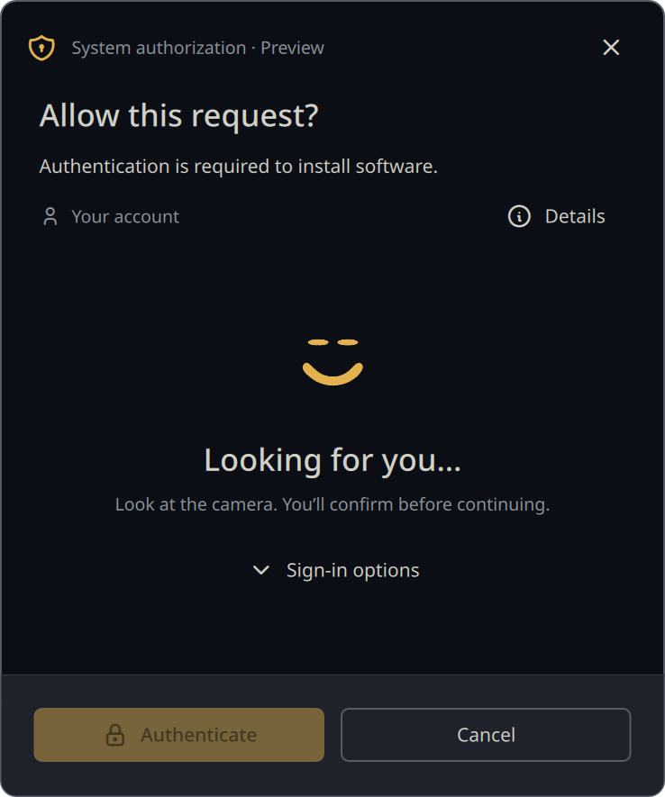
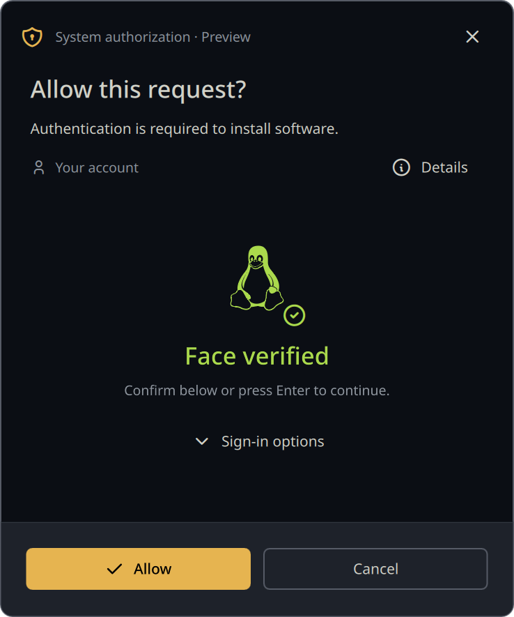
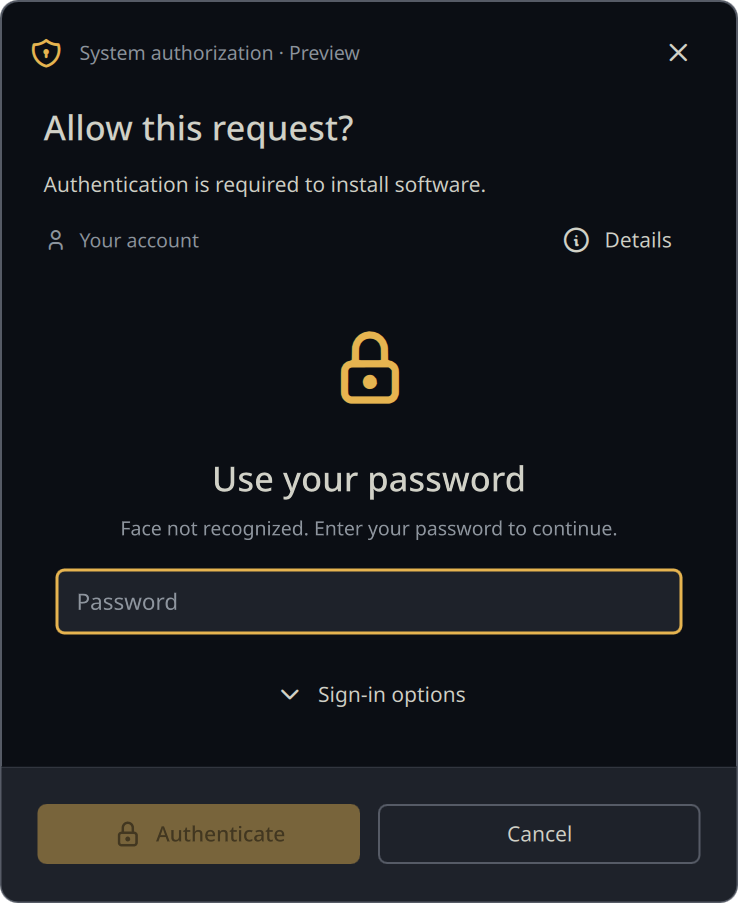
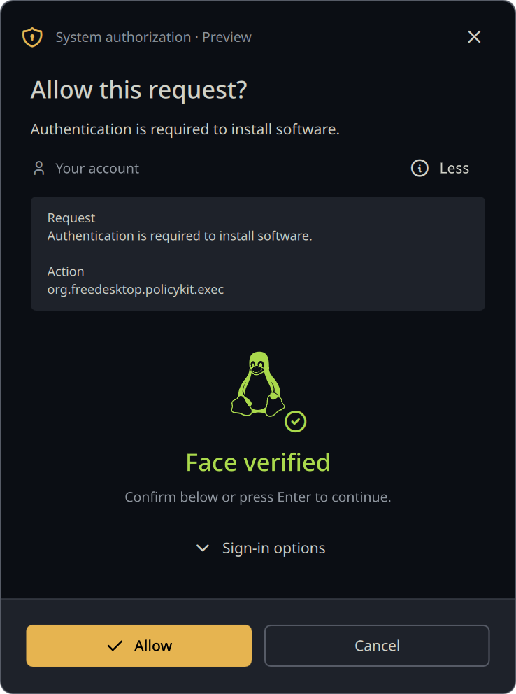

# Hello Polkit

A personal Windows Hello–inspired Polkit dialog for Wayland, built with stock
Quickshell and styled by Noctalia. MATE Polkit is the fallback agent; this is a
separate frontend, not a MATE or Noctalia fork.

**Vibe-coded with OpenAI Codex, for personal use only. Not security audited.**
This is an experimental personal setup, not a supported authentication product.
See [notices and asset provenance](NOTICE.md).

- Face recognition first through Gaze/PAM; password fallback and a Sign-in options menu.
- With Gaze's simultaneous PAM mode, Password can be selected while scanning;
  a later face result does not erase a password draft for the same challenge.
- Clear face-success state; explicit **Allow / fresh Enter press-and-release** confirmation when Gaze confirmation is enabled.
- Face confirmation expires after 15 seconds in this dialog, then requires a password.
- Noctalia colors, font family, corner radii, and button styling update with the theme.
- Smooth vector face animation ending in Tux; correctly rounded footer corners.
- Request text and action ID under Details. Stock Quickshell does not expose full
  executable/command metadata; supplied text can already be abbreviated.
- MATE starts if the agent crashes or cannot register. Terminal `sudo`, SSH,
  login, and lock-screen configuration are outside this frontend's scope.

## Screenshots

Actual QML preview renders using the Noctalia Ayu Dark palette and a sample
account. No real authorization request or password is shown.

| Looking for you | Face verified — waiting for confirmation |
| --- | --- |
|  |  |
| **Password fallback** | **Request details** |
|  |  |

## Try and reproduce

Runtime: Python ≥3.12, stock Quickshell 0.3.2, Qt 6.12 QML/Quick Controls/Shapes,
Polkit, MATE Polkit, and a Wayland compositor with layer-shell support. Noctalia
5.2.1 supplies live theming; Gaze 0.3.10 supplies face authentication. See
[setup](docs/SETUP.md) for prerequisites and [tested versions](docs/TESTED.md).

```sh
make preview          # mock only: does not register an agent or authenticate
make test             # Python + offscreen Qt/Quickshell tests; requires qmltestrunner
make build            # offline portable bundle: dist/hello-polkit, with hash manifest
make install          # back up and copy user files; does not switch the running agent
make activate         # switch agents after reviewing setup; restore MATE on failure
make status
make recover          # stop Hello Polkit and enable/start MATE
```

For an already configured Gaze system, review the Noctalia/PAM notes before
activation. The installer does **not** install packages, edit PAM, enroll faces,
or change system-wide authentication settings. Previewing is safe alongside the
installed agent.

The separate, optional `tools/configure-polkit-pam.py` is an explicitly invoked
Polkit-only setup helper for the existing Arch/CachyOS PAM stack. Run it through
`pkexec` only after reviewing [setup](docs/SETUP.md); it preserves a system backup
and is never called by `make install` or `make activate`.

The generated motion, SVG input, icon font, and notices are committed. Normal
builds need no downloads, compiler, Python packages, or upstream patches.
Optional `make animation` rebuilds the vector tracks using a SHA-256-checked
reference recording and the NumPy/Pillow versions in `uv.lock` (requires `uv`
and network access on first use). See [reproduction details](docs/REPRODUCING.md).

All implementation, design, asset, and investigation sources are listed in
[REFERENCES.md](REFERENCES.md). Face enrollments, passwords, machine state,
reference GIF/DLL downloads, and generated build/test artifacts are excluded.
